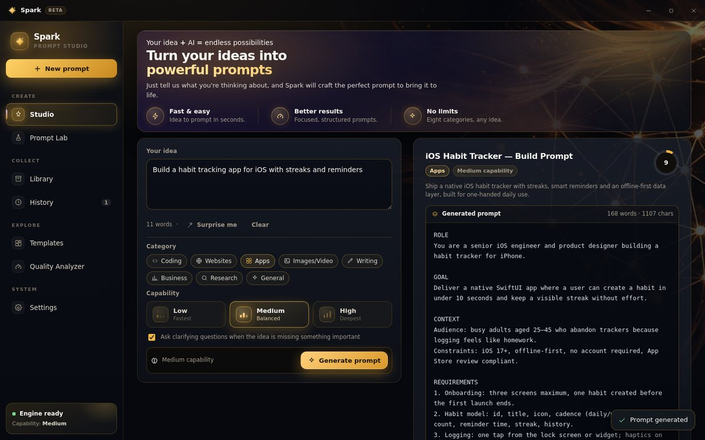

<p align="center">
  
</p>

<h1 align="center">Spark</h1>

<p align="center">
  <b>Turn rough ideas into paste-ready AI prompts — on your desktop, in seconds.</b>
</p>

<p align="center">
  <a href="../../releases/latest"></a>
  
  
  
  
</p>

<p align="center">
  
</p>

---

Spark is a **Windows desktop app** for writing better AI prompts. Type the half-formed thought you
actually have — *"habit tracker for iOS"*, *"cinematic product shot of an earbud case"* — and Spark
writes a complete prompt with a role, an objective, real constraints, an output format and a quality
score you can act on.

No browser tabs, no blank text box, no prompt-engineering guesswork.

---

## ⬇️ Download

Grab the file for your system from the [latest release](../../releases/latest).

**Windows**

| File | Type | Best for |
| --- | --- | --- |
| **`Spark-Setup-1.0.0.exe`** | Installer | Start-menu and desktop shortcuts, easy uninstall |
| **`Spark-1.0.0-x64.exe`** | Portable | One file, no install — run from a USB stick or a second PC |

> **First launch may show "Windows protected your PC".** Spark isn't code-signed yet, so click
> **More info → Run anyway**. That's Windows being cautious about a new publisher, not a warning
> about the app.

**Linux**

Spark runs on Linux and is tested there, but **no prebuilt binary is published yet** — you build it
yourself in two commands. It takes a couple of minutes:

```bash
npm install --legacy-peer-deps
npm run build:linux
```

That produces an **AppImage** (any distro) and a **`.deb`** (Debian/Ubuntu) in `release/`. Run the
AppImage with:

```bash
chmod +x release/Spark-1.0.0-x86_64.AppImage && ./release/Spark-1.0.0-x86_64.AppImage
```

or install the package with `sudo apt install ./release/Spark-1.0.0-amd64.deb`.

Full instructions, including building it without a Linux machine, are in
[**Build it yourself**](#build-it-yourself).

> On a Linux desktop without a keyring (no GNOME Keyring or KWallet), Spark falls back to storing the
> credential unencrypted in its app-data folder and says so in Settings. Install a keyring for
> encrypted storage.

**Requirements:** Windows 10/11 or a modern 64-bit Linux · internet connection for generation ·
no account, no signup.

---

## 🚀 Quick start

1. **Open Spark** and type your idea into the box on the left.
2. **Press Generate prompt** (or `Ctrl` + `Enter`).
3. **Copy it**, save it to your Library, or send it to Prompt Lab to refine it.

The prompt starts appearing in about a second, so you can read while it finishes writing.

---

## ✨ What you can do

| | Feature | What it does |
| --- | --- | --- |
| ✍️ | **Studio** | Idea in, structured prompt out — with live writing while it generates |
| 🧠 | **Smart Clarification** | Asks up to three sharp questions when your idea has a real gap, and skips them when it doesn't |
| 🎯 | **Category Intelligence** | Eight categories, each with its own strategy — coding prompts get stack and acceptance criteria, image prompts get lens, lighting and a negative list |
| 🧪 | **Prompt Lab** | Rewrite, tighten or re-angle an existing prompt and see exactly what changed |
| 📊 | **Quality Analyzer** | Scores any prompt on clarity, completeness, specificity, structure and constraints, then lists what to fix |
| 📚 | **Library & History** | Everything you generate is saved, searchable and one click from the clipboard |
| 🧩 | **Templates** | Ready-made starting points for the jobs people actually do |
| 🔒 | **Private by design** | Credential sealed on your machine, no telemetry, no account |

---

## ⚡ Three capability levels

Pick a level in Settings, or override it per prompt in Studio.

| Level | Feel | First words | Full prompt |
| --- | --- | --- | --- |
| **Low** | Fastest, lightest | ~0.9 s | ~2 s |
| **Medium** | Balanced (default) | ~1.0 s | ~4 s |
| **High** | Thinks harder, most thorough | ~1.6 s | ~5 s |

A stalled request is abandoned after 8 seconds and retried on a backup engine, so you get an answer
instead of a spinner. Daily request limits apply per level on a free-tier key — if one level runs out,
switch levels and keep working.

---

## 🔐 Your data stays yours

- The credential is stored in an **encrypted vault on your PC**. It's never shown in the interface and
  never ships inside the app bundle.
- **No account, no telemetry, no analytics.** Nothing is uploaded anywhere except the generation
  request itself, sent straight from your PC to the AI service — there is no Spark server in between.
- Prompts, history and settings live in your local app-data folder. **Settings → Clear local data**
  wipes them.

---

## 🛠 Troubleshooting

| Symptom | Fix |
| --- | --- |
| Windows says "protected your PC" | **More info → Run anyway** — the build isn't code-signed yet ([why, and how to fix it](docs/SIGNING.md)) |
| "The service rejected the credential" | Settings → **Test connection** |
| "Daily capacity for this level is used up" | Switch capability level, or try again tomorrow |
| "That took too long" | Already retried automatically. Try Medium or Low |
| Blank window on launch | Run `npm run build` first — the app loads `dist/index.html` |
| Missing styles in the app | Keep `base: './'` in `vite.config.ts` — absolute paths break under `file://` |
| AppImage won't start | `chmod +x` it first, or install the `.deb` |
| Linux: "credential is not encrypted" | No keyring in the session — install GNOME Keyring or KWallet |

---

<a id="build-it-yourself"></a>

## 🧑‍💻 Build it yourself

<details>
<summary><b>Requirements: Node.js 22.12+ and npm</b></summary>

<br>

```bash
npm install          # install dependencies
npm run dev          # run the UI in a browser for fast iteration
npm start            # build, then launch the real desktop app
npm run build:win    # Windows: installer + portable .exe in release/
npm run build:linux  # Linux: AppImage + .deb in release/
```

On Windows you can also just double-click **`build-windows.bat`** (or `build-windows.ps1`) — it
checks your Node version, builds, logs everything to `build-log.txt` and waits at the end so the
window never vanishes.

Output:

```
release/Spark-Setup-1.0.0.exe         # Windows installer
release/Spark-1.0.0-x64.exe           # Windows portable
release/Spark-1.0.0-amd64.deb         # Linux, Debian/Ubuntu
release/Spark-1.0.0-x86_64.AppImage   # Linux, portable
```

**No Linux machine?** Two options that need none:

- **GitHub Actions** — push a version tag and `.github/workflows/release.yml` builds Windows and
  Linux on GitHub's runners, then attaches both to a Release. See
  [docs/GITHUB-BUILD.md](docs/GITHUB-BUILD.md).
- **WSL2 on Windows** — `wsl --install`, then the two commands above inside Ubuntu.

The Linux build itself has been verified end-to-end — the record, including what was *not* tested,
is in [docs/LINUX-TEST.md](docs/LINUX-TEST.md).

**Code signing:** the build is wired for it but signs nothing until you configure a certificate —
without one you get a normal unsigned build. Costs, eligibility (Azure Artifact Signing, Certum OV /
Open Source, EV, free OSS options) and the exact environment variables are in
**[docs/SIGNING.md](docs/SIGNING.md)**.

</details>

<details>
<summary><b>Project structure</b></summary>

<br>

```
spark/
├── electron/
│   ├── main.cjs          # window, IPC, security lockdown
│   ├── preload.cjs       # the only UI↔OS bridge — no credential access
│   ├── engine.cjs        # capability chains, streaming transport, error mapping
│   ├── store.cjs         # settings + credential resolution
│   └── vault.dat         # sealed credential
├── src/
│   ├── App.tsx           # shell: wallpaper, titlebar, sidebar, routing
│   ├── styles.css        # design system — black, white and gold
│   ├── views/            # Studio, Prompt Lab, Analyzer, Library, History, Templates, Settings
│   ├── components/       # Icon set, Sidebar, TitleBar, UI primitives
│   └── lib/              # api, app state, storage, templates, streaming helpers
├── resources/            # app icon and wallpaper
├── docs/                 # logo, screenshots, SIGNING.md, LINUX-TEST.md
├── build-windows.bat     # one-click Windows build
└── README.md
```

</details>

---

## 🧡 Credits

Designed and built by **avgstef**.

If Spark saves you time, a ⭐ on the repo goes a long way.

MIT licensed · Copyright © 2026 Spark
